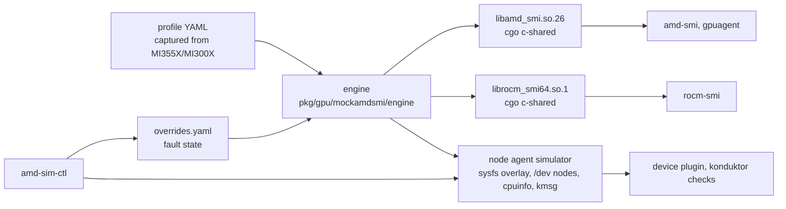

# MEP-1001: AMD GPU Simulator

Author: [Andrew Aikawa](https://github.com/asaiacai) (Trainy)

Status: **in progress**. Wave 0 (spike) is complete and returned GO; Wave 1
(contracts) is the PR that adds this document.

> **Numbering.** This MEP lives in Trainy's fork of Mokka. Fork MEPs are
> numbered from 1001 so they never collide with upstream's sequence when the
> fork merges upstream `main`.

<!-- toc -->
- [Summary](#summary)
- [Motivation](#motivation)
  - [Goals](#goals)
  - [Non-Goals](#non-goals)
- [Proposal](#proposal)
  - [User Stories](#user-stories)
  - [Notes/Constraints/Caveats](#notesconstraintscaveats)
  - [Risks and Mitigations](#risks-and-mitigations)
- [Design Details](#design-details)
  - [Seams](#seams)
  - [Architecture](#architecture)
  - [Contracts (Wave 1)](#contracts-wave-1)
  - [Fault model](#fault-model)
  - [Fidelity: capture from real hardware](#fidelity-capture-from-real-hardware)
  - [Delivery](#delivery)
  - [Execution plan](#execution-plan)
  - [Wave 0 evidence](#wave-0-evidence)
- [Drawbacks](#drawbacks)
- [Alternatives](#alternatives)
<!-- /toc -->

## Summary

Mokka lets the real NVIDIA consumers (device plugin, `nvidia-smi`, DCGM) run on
CPU-only Kubernetes nodes against simulated GPUs with fault injection. Nothing
equivalent exists for AMD. Run:ai's fake-gpu-operator and Mokka are
NVIDIA-only; AMD's `gpuagent_mock` and mock metrics exporter cannot inject ECC
or XGMI faults and provide neither `amd-smi` nor the device plugin.

This MEP adds an AMD simulator to the fork, built on Mokka's pattern rather
than its NVML code: replacement `libamd_smi.so.26` and `librocm_smi64.so.1`
libraries over one Go engine, plus a node agent that presents the same engine
state as sysfs and `/dev` nodes. The real `amd-smi` and `rocm-smi` CLIs, the
real `rocm/k8s-device-plugin` and konduktor's AMD health checks then run
unmodified in kind, and faults injected at runtime show up identically on
every surface.

## Motivation

Konduktor runs an AMD health stack on MI355X fleets
(`docker/trainy-npd/checks/amd_*.py`, eight modules). Each check is unit-tested
against canned text, but none runs end to end:

- no test runs `amd-smi` itself, so CLI schema drift across amd-smi versions
  (where the checks have broken before) is caught only in production;
- no test exercises `/dev/kfd` open semantics, the device-plugin socket or the
  real sysfs layout;
- no test drives an `amd-*` NodeCondition through to remediation (cordon,
  drain, reboot, uncordon).

We now have AMD hardware access, so profiles and golden outputs can be
captured from real MI300X/MI355X nodes instead of written from documentation.

### Goals

1. Run the real `amd-smi` CLI, the real `rocm/k8s-device-plugin` and
   konduktor's AMD checks, unmodified, on kind nodes with no GPU.
2. Inject, at runtime, every fault behind an `amd-*` condition konduktor acts
   on, plus `amdgpu` kernel-log lines, so a test can assert the full loop:
   inject → NodeCondition → controller → cordon/drain → simulated reboot →
   clear → uncordon.
3. Schedule against `amd.com/gpu` in kind (Kueue quota, JobSet placement).
4. Use profiles and golden CLI output recorded from real hardware, with
   contract tests that fail when the simulator drifts from it.

### Non-Goals

- HIP/ROCm kernels, RCCL, RVS, AGFHC. Active checks keep their fakes.
- Performance, thermal behaviour, or a data path (XGMI/RDMA traffic).
- Driver install or upgrade.
- Changing upstream Mokka. AMD code lives in new paths only (see
  [Layout](#layout-in-the-fork)) so upstream merges stay conflict-free.

## Proposal

Replace the two SMI libraries, not the kernel interface. Generate a
`NOT_SUPPORTED` stub for every export from the ROCm headers, the way Mokka
generates its NVML bridge, and implement only the functions the consumers
call. One engine answers the library calls and drives the node agent's sysfs
renderer, so `amd-smi` and sysfs cannot disagree unless a test sets that up.

### User Stories

#### Story 1: positive health-check tests

A konduktor CI job creates a two-node kind cluster with the simulator, installs
the remediation stack with its AMD values, runs `amd-sim-ctl ecc --gpu 2
--block umc --ue 3` on one node, and asserts that `amd-GpuEcc` turns True with
the expected reason, that the node is cordoned and drained, and that
`amd-sim-ctl healthy` clears it after the simulated reboot.

#### Story 2: amd-smi version drift

A ROCm bump adds a library call to `amd-smi metric --ecc`. The census test
fails because the new function is a stub, before any check silently reports
`N/A`.

### Notes/Constraints/Caveats

- **The CLI bypasses the library.** `amd-smi` reads
  `/sys/module/amdgpu/initstate` (and exits before any call unless it reads
  `live`), `/proc/cpuinfo`, and stats `/dev/kfd`. These are listed in
  `pkg/gpu/mockamdsmi/sysfs` and staged by the node agent.
- **Cloud hosts look like VMs.** With the `hypervisor` CPU flag set, `amd-smi`
  drops `bad-pages` and rejects `static --limit`. kind nodes on a cloud VM
  inherit the flag, so the simulator presents a `/proc/cpuinfo` without it.
- **DRM index collisions.** A cloud VM's virtual display (Azure `hyperv_drm`
  `card1`) shows through into kind; a simulated `card1` silently lost its
  `mknod` and a workload received the host's real DRM node. GPU DRM indices
  are explicit in the profile and the node agent remaps on collision.
- **Shared kernel ring buffer.** kind nodes share one kernel, so every
  injected `amdgpu` line names its GPU's BDF and assertions key on it.

### Risks and Mitigations

| Risk | Mitigation |
|---|---|
| ABI drift: amdsmi structs change across ROCm releases | Pinned ROCm version, export-list reconciliation at generation time, struct-layout tests (Wave 2), a version matrix |
| False confidence: everything returns `NOT_SUPPORTED` and still exits 0 | Positive assertions only; a census test per amd-smi version that every called function is implemented |
| Synthetic values hide real-format bugs | Golden contract tests against captured output; the example profile is marked synthetic until replaced |
| Library and sysfs disagree | One engine renders both; KFD `io_links` and `amdsmi_topo_*` come from the same XGMI map |

## Design Details

### Seams

| Consumer | Reads via | Simulated by |
|---|---|---|
| `amd-smi` CLI (Python) | ctypes → `libamd_smi.so.26`; also `/sys/module/amdgpu/initstate`, `/proc/cpuinfo`, `/dev/kfd` directly | replacement library + staged files |
| `rocm-smi` CLI | `librocm_smi64.so.1` (a separate library: `libamd_smi` embeds its own copy) | second replacement library, same engine |
| konduktor checks | the two CLIs, `/sys/bus/pci/devices`, KFD topology, `/sys/module/amdgpu/version`, `/dev/kfd` open RW, `/dev/dri/renderD*`, plugin socket, kmsg | all of the above |
| `rocm/k8s-device-plugin` (Go) | sysfs only: `drivers/pci:amdgpu/<BDF>`, partitions, `drm/card*`/`renderD*`, KFD `properties` and `io_links` | sysfs overlay (`LD_PRELOAD` cannot reach Go) |
| device-metrics-exporter → gpuagent | `libamd_smi.so` | same library (later phase) |
| node labeller | libdrm ioctls | out of scope; use NFD labels |

### Architecture



### Contracts (Wave 1)

Every later task codes against these. A change to them after Wave 1 is a
reviewed change to this MEP, not something an implementation PR does on the
side.

| Package | Contract |
|---|---|
| `pkg/gpu/mockamdsmi/profile` | Node profile schema (YAML, snake_case like the NVML configs), strict decoding, `gpu_defaults` and `xgmi_full_mesh` shorthands, whole-profile validation |
| `pkg/gpu/mockamdsmi/overrides` | Fault-state document, deep-merge semantics, change detection, locked atomic updates |
| `pkg/gpu/mockamdsmi/engine` | `Engine`/`Query` read interface, the census map from library function to `Query` method, the in-memory implementation |
| `pkg/gpu/mockamdsmi/faults` | The fault catalog as typed operations compiled to override patches and one-shot actions; kernel-log templates |
| `pkg/gpu/mockamdsmi/sysfs` | Every path the consumers read and its engine source, the overlay mount points, the `Renderer` interface, the in-place write rule |

**Override document.** Patch levels are deep-merged over the profile in the
order `profile < all < gpus[<bdf>]` for GPUs, and `profile < node` for node
state. Maps merge; scalars, lists and `null` replace. Per-GPU patches are
keyed by **BDF**, not index: an amd-smi index shifts when a GPU is lost, a BDF
never does, and it is the key the kernel log and konduktor's assertions use.
The merged state is validated exactly like a profile file, and a document that
fails is rejected while the last good state stays in force.

```yaml
version: 1
node:
  driver: {initstate: missing}
  smi_faults:
    wedge: {argv: "metric --ecc", delay_ms: 40000}
all:
  ecc: {blocks: {umc: {correctable: 5}}}
gpus:
  "0000:15:00.0":
    pcie: {width: 8}
    xgmi: {links: {"0000:05:00.0": {down: true}}}
```

**Change detection.** The census counted ~900 handle lookups for a single
`amd-smi list`, so the per-call path must never re-parse. The store stats the
file at most once per TTL (1 s), re-reads only when its fingerprint changes,
and keys the engine's cached state on a generation counter. Writers replace
the file by rename, so the fingerprint includes the inode: two same-size writes
inside one mtime tick still register.

### Fault model

| Fault (`faults.*`) | Engine effect | Surfaces through | Condition |
|---|---|---|---|
| `ECC{Block, UE, CE, Deferred, CorrectablePerHour}` | RAS counters per block | `metric --ecc`, `monitor -e`, `rocm-smi --showrasinfo`, `ras/*_err_count` | `amd-GpuEcc` |
| `BadPages{Retired, Pending, Unreservable}` | retired-page table | `bad-pages [--json]`, `ras/gpu_vram_bad_pages` | `amd-GpuBadPages` |
| `PCIe{Width, SpeedMTs, Replays}` | link state | `metric --pcie`, `current_link_width` | `amd-GpuPcie` |
| `XGMI{Peer, Down, WAFLUncorrected}` | link state (both ends), `xgmi_wafl` RAS | `topology -a -t`, `rocm-smi --showtopo*`, KFD `io_links` | `amd-Xgmi` |
| `Presence{lost \| fallen_off_bus}` | enumeration; PCI config reads all-ones | `list`, PCI sysfs, device plugin | `amd-GpuCount` |
| `Temperature{Sensor, Metric, Celsius}` | sensors | `metric --temperature`, `static --limit`, `rocm-smi --showtemp` | `amd-GpuThermal` |
| `Driver{InitState, Version}` | module files | `/sys/module/amdgpu/*`, `amd-smi version` | `amd-GpuDriver` |
| `KFD{missing \| regular_file \| unopenable}` | `/dev/kfd` node; unopenable is `c 511:0` (ENXIO) | `amd_kfd.py` | `amd-Kfd` |
| `Kmsg{ring-timeout \| gpu-reset \| ras-ue \| poison \| xgmi-pcs}` | none (action) | `/dev/kmsg` in upstream `amdgpu` format | kernel-error condition |
| `SMI{Functions, Argv, DelayMs, AfterCalls, Status}` | library blocks or fails | SMI timeout paths (NPD's 30 s budget) | `amd-GpuDriver` or UNKNOWN |
| `KillPlugin` | none (action) | plugin socket | device-plugin condition |
| `Healthy{GPU \| AllGPUs}` | clear overrides | every surface | conditions clear |

A `/dev/kfd` that exists but denies write cannot be simulated: the checks run
as root, which bypasses mode bits, and `1:3` is in runc's default device
allow-list. The catalog leaves it out rather than offering a fault that
cannot fire.

### Fidelity: capture from real hardware

1. **Capture.** A read-only script (`tools/amd-capture/`) snapshots a real
   node's sysfs subtrees, every `amd-smi`/`rocm-smi` invocation the checks
   make, versions, library fingerprints and `amdgpu` kernel-log lines. A human
   runs it on MI355X and MI300X nodes.
2. **Contract tests.** The engine, loaded with a captured profile, must
   reproduce the golden CLI output per subcommand after normalising volatile
   fields (timestamps, live power, the KFD `major:minor`).
3. **Fault goldens.** Where the fleet has seen real faults, their `amd-smi`
   and dmesg output become goldens the injected fault must match in shape.

### Delivery

- **sysfs: node-level overlayfs, not bind mounts.** `/sys/module/amdgpu` and
  `/sys/class/kfd` do not exist on a non-AMD host and runc cannot create a
  mount point in read-only sysfs. The node agent mounts an overlay with the
  real sysfs as the lower layer on `/sys/module`, `/sys/class` and
  `/sys/bus/pci/devices`, from the node's mount namespace, before the device
  plugin starts (it checks `/sys/class/kfd` once).
- **In-place writes.** After an atomic rename in the overlay's upper
  directory, the overlay kept serving the old unlinked inode. The renderer
  truncates and rewrites files in place (`sysfs.WriteInPlace`); structural
  changes such as a lost GPU remount.
- **`/dev` nodes.** `mknod c 1 3` (the `/dev/null` numbers): `S_ISCHR`, opens
  read-write, and the device plugin's DeviceSpecs deliver it to pods. No CDI
  and no custom kind node image are needed.
- **Real binaries.** The image ships `amd-smi`, `rocm-smi` and `rocm-core`
  from the pinned ROCm debs, with every copy of the libraries replaced (the
  amd-smi deb carries a second `libamd_smi.so` under `share/amd_smi/amdsmi/`).

### Execution plan

Contracts first, then fan out. Each task is one subagent in its own worktree
opening one PR; the lead owns the contracts, reviews, and integrates.

| Wave | Task | Output |
|---|---|---|
| 0 (done) | S1 call census, S2 device plugin on staged sysfs, S3 `/dev/kfd` and CDI, S4 capture script | GO on option B; census; bypass list |
| 1 (this stack) | C0 contracts | the five packages above, an example profile, the ABI stub generator, CI |
| 2 | W1 engine extensions (`gpu_metrics` assembly, rate/after-calls state) | |
| 2 | W2 library bridges: cgo c-shared for both libraries, census implementations, struct-layout tests, census contract test (`SMI_STUB_LOG`) | |
| 2 | W3 node agent simulator: `Renderer`, overlay mounts, `/dev` staging, `/proc/cpuinfo`, DRM remap, Helm chart | |
| 2 | W4 `amd-sim-ctl` over `faults`, kmsg writer, kill-plugin | |
| 2 | W5 captured profiles and goldens (needs the S4 human run) | |
| 3 | L1–L5 one agent per amd-smi subcommand group, each with its golden test | |
| 4 | konduktor: scheduling tests, the `t10-amd` remediation testbed, per-condition fan-out | konduktor consumes the fork's published images and chart |

The critical path is census → contracts → W1/W2 → L* → konduktor testbed, with
the hardware capture gating W5 and L*.

#### Layout in the fork

AMD code lives only in new paths, so upstream merges never conflict:
`pkg/gpu/mockamdsmi/...`, `cmd/generate-amdsmi-bridge/`, later
`cmd/amd-sim-ctl/` and `deployments/amd-sim/`, `tools/amd-capture/`,
`enhancements/meps/1001-*`, and `.github/workflows/amd-sim.yaml`. It reuses
Mokka packages (`internal/fsutil`, the node agent's `Simulator`/`Applier`
lifecycle, the override merge semantics) by import, never by copying, and it
adds no dependencies to `go.mod`.

### Wave 0 evidence

Pinned: ROCm 7.2.1 (noble debs `amd-smi-lib` 26.2.2.70201, `rocm-smi-lib`
7.8.0.70201), `rocm/k8s-device-plugin:1.31.0.9`, `kindest/node:v1.34.0`
(containerd 2.1.3).

- **amd-smi runs on a replacement library.** The real 26.2.2 CLI ran every
  invocation konduktor's checks make against a stub `libamd_smi.so` (all 192
  exports, 14 hand-written), every one exiting 0. `amd-smi list --json`
  returned 8 MI355X-shaped GPUs from the stub plus one staged file
  (`initstate` = `live`).
- **Census.** 25 of 192 amdsmi exports need real implementations (7 plumbing,
  18 data); 13 of 116 rsmi exports. `pkg/gpu/mockamdsmi/engine/census.go` maps
  each to its `Query` source. A deep pass with zero-filling `SUCCESS` stubs
  drove every code path to the end (`topology` grows from 1 call to 344).
- **Exports.** All 192 must exist: `amdsmi_wrapper.py` binds every symbol at
  import, and its list matches `nm -D` of the real library exactly (145
  GPU/common + 47 ESMI CPU).
- **Device plugin.** The upstream DaemonSet, unmodified, advertised
  `amd.com/gpu: 8` from a staged tree; a pod limited to 2 GPUs received
  `/dev/kfd`, two `card*` and two `renderD*` nodes and opened each read-write.
  Without KFD `io_links` the plugin falls back to kubelet's allocator.
- **`/dev/kfd`.** `amd_kfd.py`, unmodified: `c 1 3` passes; missing,
  regular-file and `c 511 0` (ENXIO) each fail with the expected message; mode
  `0444` still passes under root.
- **CDI** is enabled in stock kind but only arrives through kubelet (device
  plugin `CDIDevices` or DRA), and plain DeviceSpecs suffice, so it is dropped.

## Drawbacks

- Two hand-maintained libraries track AMD's ABI, which changes across ROCm
  releases. The generator and the census test make that drift loud, not
  free.
- A synthetic profile can pass tests a real node would fail. Until captures
  land, only the shape of the output is trustworthy.

## Alternatives

- **Run the real `libamd_smi` over synthetic sysfs, plus libdrm and `/dev/kfd`
  ioctl emulation.** Highest nominal fidelity, but it needs the versioned
  binary `gpu_metrics` blob, DRM `AMDGPU_INFO_*` ioctls and KFD
  `GET_VERSION`/`SMI_EVENTS`, and the root-override environment variables are
  compiled out of release builds. Fragile across ROCm releases.
- **Replace the Python `amdsmi` package or wrap the CLI.** Cheapest, but it
  skips the CLI's own parsing and formatting, which is exactly where the
  checks have broken across amd-smi versions.
- **A standalone repository, or a directory in konduktor.** Rejected in favour
  of the fork: the fork is already the GPU-simulation dependency konduktor
  consumes, and living in Mokka's module lets the AMD simulator reuse its node
  agent, override pattern, Helm conventions and e2e harness directly.
